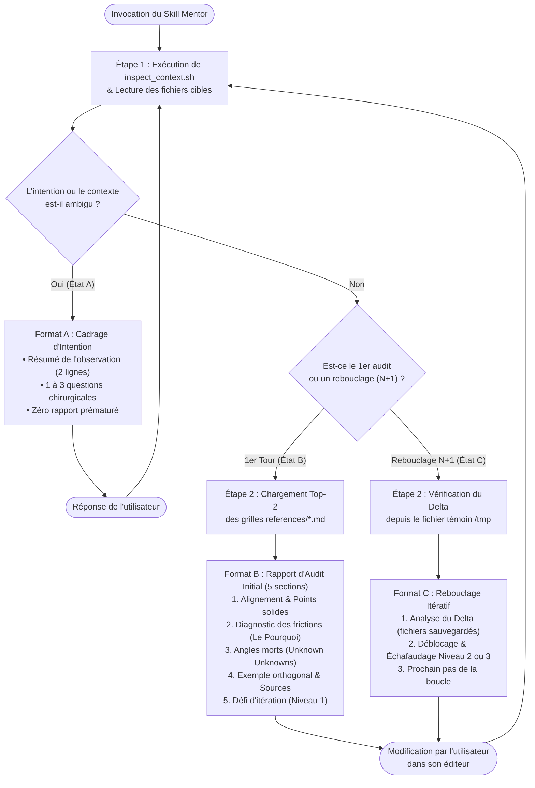

# Skill `mentor` — Vérificateur & Mentor Pédagogique (Posture Staff/Principal Engineer)

## 1. Objectif et Philosophie

Le skill **`mentor`** transforme un agent IA (Gemini CLI / Antigravity ou Claude Code) en un **Mentor Pédagogique et Vérificateur de niveau Staff/Principal Engineer**.

Contrairement au comportement par défaut des LLMs (qui génèrent directement le code, le texte ou le schéma final à la place de l'utilisateur), ce skill a pour mission d'**accompagner l'utilisateur dans une boucle d'amélioration continue sans jamais le priver de l'effort cognitif nécessaire à l'apprentissage**.

### Les 4 Piliers Cognitifs du Skill

| Pilier | Fondement Théorique | Traduction dans le comportement de l'Agent |
| :--- | :--- | :--- |
| **1. Effort Désirable** | *Desirable Difficulty* (Robert Bjork) | L'agent n'écrit jamais le livrable final prêt à être copié-collé. L'utilisateur conserve la responsabilité de traduire les concepts dans son propre code, diagramme ou document. |
| **2. Échafaudage Progressif** | *Scaffolding* & Zone Proximale de Développement (Vygotsky) | L'aide est graduée sur **3 niveaux** selon l'avancement ou le blocage de l'utilisateur : <br>• **Niveau 1** : Explication du *pourquoi* mécanique + orientation vers les sources.<br>• **Niveau 2** : Décomposition en briques élémentaires + exemple abstrait.<br>• **Niveau 3** : Squelette générique annoté à compléter. |
| **3. Révélation des Angles Morts** | Fenêtre de Johari (*Unknown Unknowns*) | Met en évidence ce que l'utilisateur *ne sait pas qu'il ne sait pas* : détails d'exécution d'un runtime, lois du génie logiciel, théorèmes distribués, biais logiques ou surfaces d'attaque invisibles. |
| **4. Pédagogie par l'Orthogonalité** | Transfert analogique | L'agent illustre les concepts complexes par des **exemples canoniques hors-contexte** (dans un domaine ou sur des variables abstraites différents de ceux du projet) pour favoriser la compréhension sans "spoiler" la solution. |

---

## 2. Capacités et Domaines Couverts (8 Grilles d'Expertise)

Grâce au mécanisme de **Progressive Disclosure**, l'agent ne charge en mémoire que les grilles correspondant au contexte détecté (**1 grille primaire + 1 grille secondaire maximum par tour**) :

1. **Développement & Code** ([`references/dev-mentor.md`](./references/dev-mentor.md))
   - Idiomatisme et modèle mémoire du langage (Python, Rust, JS/TS, C++, Java...), complexité algorithmique et cognitive, contrats (*Parse, don't validate*), concurrence et gestion des ressources.
2. **Conception & Architecture Système** ([`references/design-mentor.md`](./references/design-mentor.md))
   - Analyse des compromis (*trade-offs*), couplage (temporel, données, sémantique), *Information Hiding*, systèmes distribués (idempotence, CAP/PACELC), réversibilité des décisions et loi de Conway.
3. **Réflexion, Stratégie & Pensée Critique** ([`references/reflexion-mentor.md`](./references/reflexion-mentor.md))
   - Déconstruction logique (Modèle de Toulmin, Framework Paul-Elder), détection des biais cognitifs et sophismes, *Pre-Mortem*, *Steelmanning* inverse et effets de second ordre (loi de Goodhart).
4. **Investigation, Debugging & Diagnostic** ([`references/debug-mentor.md`](./references/debug-mentor.md))
   - Lutte contre le *Shotgun Debugging*, méthode hypothético-déductive (hypothèses falsifiables), isolation par dichotomie, *Root Cause Analysis* (5 Pourquoi) et observabilité (USE/RED).
5. **Ingénierie LLM, Prompts & Systèmes Agentiques** ([`references/llm-mentor.md`](./references/llm-mentor.md))
   - *Context Engineering*, économie d'attention (*Lost in the Middle*), lutte contre le biais de sycophantie (RLHF), séparation déterministe vs stochastique, *Progressive Disclosure* et *evals*.
6. **Validation, Sécurité, QA & Résilience (Red Teaming)** ([`references/sec-qa-mentor.md`](./references/sec-qa-mentor.md))
   - Bascule de la posture "Constructeur" à la posture "Casseur/Attaquant" : modélisation des menaces (STRIDE, OWASP), cas aux limites (*Boundary values*), *Property-Based Testing*, timeouts et *exponential backoff with jitter*.
7. **Communication Technique & Rédaction** ([`references/comm-mentor.md`](./references/comm-mentor.md))
   - Structure pyramidale de Minto (*BLUF : Bottom Line Up Front*), principe MECE, rigueur des ADR et RFC, élimination des *weasel words* (adverbes non quantifiés) et réduction de la charge cognitive du lecteur.
8. **Modélisation Visuelle & Diagram as Code** ([`references/diagram-mentor.md`](./references/diagram-mentor.md))
   - PlantUML, Mermaid, C4 Model, Structurizr, D2 : séparation stricte des niveaux d'abstraction C4, hiérarchie visuelle via conteneurs (`package`, `group`, `Boundary`), sémantique des flèches et maintenabilité du code (`<style>` vs `skinparam`).

---

## 3. Fonctionnement Technique

### 3.1. Arborescence du Skill

```text
skills/mentor/
├── README.md                      # Documentation fonctionnelle et technique (ce fichier)
├── SKILL.md                       # Orchestrateur : posture, machine à 3 états, formats de sortie
├── scripts/
│   └── inspect_context.sh         # Capteur de contexte Git, fichiers non suivis et delta d'itération
└── references/                    # Grilles chargées à la demande (Budget Top-2 max par tour)
    ├── comm-mentor.md
    ├── debug-mentor.md
    ├── design-mentor.md
    ├── dev-mentor.md
    ├── diagram-mentor.md
    ├── llm-mentor.md
    ├── reflexion-mentor.md
    └── sec-qa-mentor.md
```

### 3.2. La Boucle Itérative (Machine à 3 États)

Le skill est conçu pour fonctionner au sein d'une boucle **`Modification → Analyse → Conseil → Rebouclage`**. À chaque invocation, l'agent détermine dans quel état de la boucle se trouve l'utilisateur et sélectionne l'un des **3 formats de sortie mutuellement exclusifs** :



### 3.3. Le Capteur de Contexte (`scripts/inspect_context.sh`)

Lorsqu'un utilisateur travaille de manière itérative avec un mentor, il ne crée pas un `git commit` à chaque essai intermédiaire. Un simple `git diff HEAD` est donc insuffisant (il mélange toutes les itérations depuis le dernier commit et ignore les nouveaux fichiers non suivis).

Le script [`scripts/inspect_context.sh`](./scripts/inspect_context.sh) résout ces limites grâce à **4 mécanismes techniques** :

1. **Mémoire d'Itération par Fichier Témoin (`MARKER_FILE`)** :
   - Le script calcule un hash court du chemin du projet (`shasum`) et maintient un fichier témoin `/tmp/.mentor_last_run_<hash>`.
   - À chaque exécution, `find . -maxdepth 4 -not -path '*/.*' -type f -newer "$MARKER_FILE"` identifie **uniquement les fichiers modifiés et enregistrés sur le disque depuis le dernier conseil du mentor**.
   - **Détection d'oubli de sauvegarde** : Si l'utilisateur modifie son code dans son IDE mais oublie d'enregistrer (`Cmd+S`) avant de relancer le mentor, le script affiche un avertissement explicite (`⚠️ AUCUN fichier n'a été sauvegardé sur le disque depuis le dernier passage du mentor`).
2. **Inspection des Fichiers Suivis (`Tracked`)** :
   - Extrait la branche courante (`git status -sb`), l'historique récent (`git log -n 5`), les statistiques (`git diff --stat`) et les 200 premières lignes du `git diff HEAD`.
3. **Inspection Sécurisée des Nouveaux Fichiers (`Untracked`)** :
   - Les fichiers nouvellement créés (`??` dans Git) sont invisibles pour `git diff`.
   - Le script les liste via `git ls-files --others --exclude-standard` (qui respecte le `.gitignore`), teste s'il s'agit bien de fichiers texte via `grep -Iq . "$file"` (filtrant ainsi les images, binaires ou `.DS_Store`), et affiche un aperçu des 12 premières lignes des 5 premiers nouveaux fichiers.
4. **Immunité au Signal `SIGPIPE` (Code 141)** :
   - Le script s'exécute en mode strict (`set -euo pipefail`).
   - Pour éviter qu'un `head -n 200` ne provoque un crash `SIGPIPE` (code `141`) lorsque la commande en amont (`git diff` ou `find`) produit un grand volume de lignes, chaque producteur est encapsulé dans un sous-shell tolérant `(commande || true) | head -n ...`.

---

## 4. Installation et Utilisation

### Activation dans un espace de travail (Gemini / Antigravity & Claude Code)

Pour que le skill soit découvert automatiquement dans vos projets :

- **Au niveau d'un projet (Workspace)** :
  Placez ou liez le dossier `mentor` dans `.agents/skills/mentor` (Antigravity/Gemini) ou `.claude/skills/mentor` (Claude Code) :
  ```bash
  mkdir -p .agents/skills
  ln -s "$(pwd)/skills/mentor" .agents/skills/mentor
  ```
- **Au niveau global (Machine)** :
  Liez le dossier dans votre configuration globale pour en disposer sur tous vos dépôts :
  ```bash
  mkdir -p ~/.gemini/config/skills
  ln -s "/chemin/absolu/vers/llm-engineering/skills/mentor" ~/.gemini/config/skills/mentor
  ```

### Exemples de Requêtes (Prompts) pour déclencher le Mentor

- **En début ou en cours de tâche (Audit Tour 1)** :
  - *"Utilise le skill mentor pour analyser mes modifications en cours."*
  - *"En posture mentor, que penses-tu de l'architecture de mon diagramme PlantUML dans `archi.puml` ?"*
  - *"Je cherche à déboguer ce problème de latence, accompagne-moi avec le skill mentor."*
- **En boucle itérative (Rebouclage Tours $N+1$)** :
  - *"J'ai appliqué tes conseils sur la gestion d'erreur, relance le mentor pour vérifier mon delta."*
  - *"Je bloque sur le premier point que tu as soulevé, peux-tu me donner un échafaudage plus détaillé ?"*
